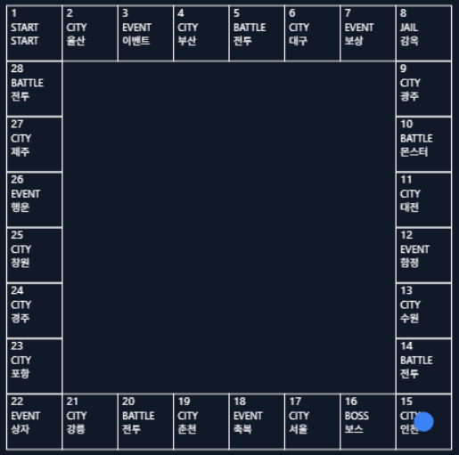

# 🎲 DiceVerse Online

> 주사위를 굴려 보드를 달리고, 이벤트를 만나고, 몬스터와 싸우며 성장하는 **턴제 보드 RPG 웹게임**



브라우저만 있으면 됩니다. 설치도 로그인도 없이, 최신 **Chrome** 에서 바로 즐길 수 있습니다. (Windows / macOS / Linux)

---

## 게임 소개

DiceVerse Online 은 복잡한 조작이 필요한 실시간 MMORPG 가 아니라, **주사위 한 번으로 한 턴이 진행되는 가벼운 보드 RPG** 입니다.

- 🎲 **주사위를 굴리면** 나온 눈의 합만큼 영웅이 보드 위를 이동합니다
- 🗺️ **36칸 보드** 를 한 바퀴 돌며 도시, 이벤트, 전투, 보스 칸을 만납니다
- ❤️ **HP · MP · 골드** 로 영웅의 상태를 확인합니다
- 🌏 **한국어 / English** 를 게임 중에 바로 바꿀 수 있습니다
- 📱 PC 와 모바일 화면에 맞춰 크기가 조절됩니다

## 플레이 방법

1. **주사위 굴리기** 버튼을 누르거나 키보드 **Space** 를 누릅니다
2. 영웅이 나온 눈의 합만큼 보드를 따라 이동합니다
3. 도착한 칸에서 무슨 일이 벌어질지 확인하고, 다음 턴을 이어갑니다

화면 하단에서 현재 턴, 주사위 결과, HP · MP · 골드, 언어 전환을 볼 수 있습니다.

## 보드의 칸

| 칸     | 설명                                |
| ------ | ----------------------------------- |
| 출발   | 모험이 시작되는 칸                  |
| 도시   | 울산, 부산, 서울 등 여러 도시       |
| 이벤트 | 보상, 함정, 행운 같은 사건이 일어남 |
| 전투   | 몬스터와의 싸움                     |
| 보스   | 강력한 보스와의 승부                |

> 이벤트·전투·보스 칸은 HP · 골드가 실제로 변하며, 출발 칸을 지나면 보상을 받습니다. 레벨업과 장비는 개발 중입니다.

---

## 개발 현황

| 기능                           | 상태         |
| ------------------------------ | ------------ |
| 보드 · 영웅 화면               | ✅ 완료      |
| 주사위 굴리기 · 턴 · 이동 연출 | ✅ 완료      |
| 상태창 (HP / MP / 골드)        | ✅ 완료      |
| 한국어 / English 전환          | ✅ 완료      |
| 이벤트 · 전투 · 보스           | ✅ 완료      |
| 성장 (레벨 · MP 사용)          | 🔧 개발 예정 |
| 몬스터 · 아이템 · 장비         | ⬜ 계획      |
| 로그인 · 저장 · 멀티플레이     | ⬜ 계획      |

### 앞으로의 계획

- 레벨업과 장비, 도시 칸 효과
- 일본어, 중국어 등 언어 추가
- 계정과 진행 상황 저장, 다른 플레이어와 협력·경쟁

---

## 직접 실행해 보기

[Node.js](https://nodejs.org) 22 이상이 필요합니다.

```bash
git clone https://github.com/minias/DVO.git
cd DVO/frontend
npm install
npm run dev
```

브라우저에서 http://localhost:5173 을 열면 게임이 시작됩니다.

## 개발에 참여하기

버그 제보, 번역, 코드 기여를 환영합니다. 자세한 방법은 [CONTRIBUTING.md](CONTRIBUTING.md) 를 참고하세요.

<details>
<summary>기술 스택과 폴더 구조 (개발자용)</summary>

### 기술 스택

- SvelteKit 2 / Svelte 5 (Runes), TypeScript, Tailwind CSS 4
- Canvas 2D 렌더링, Paraglide 다국어 (`frontend/messages/{ko,en}.json`)
- Vite, Vitest, ESLint, Prettier
- 향후 백엔드: Go, MariaDB, Redis

### 폴더 구조

```text
frontend/messages/     번역 메시지 (ko, en)
frontend/src/config/   게임 수치 설정 (보드, 주사위, 렌더링 등)
frontend/src/game/     프레임워크와 무관한 게임 로직 (보드, 주사위, 세션, 렌더러)
frontend/src/lib/      화면 컴포넌트 (상태창, 액션 바, 언어 전환)
frontend/src/routes/   페이지
docs/                  문서와 이미지
```

### 개발 명령어 (`frontend/` 에서 실행)

```bash
npm run check      # 타입 검사
npm test           # 단위 테스트
npm run verify     # check → lint → test → build 전체 검증
```

</details>

## 라이선스와 보안

- 라이선스: [GPL-3.0](LICENSE)
- 보안 취약점 제보: [SECURITY.md](SECURITY.md)
- 행동 강령: [CODE_OF_CONDUCT.md](CODE_OF_CONDUCT.md)
